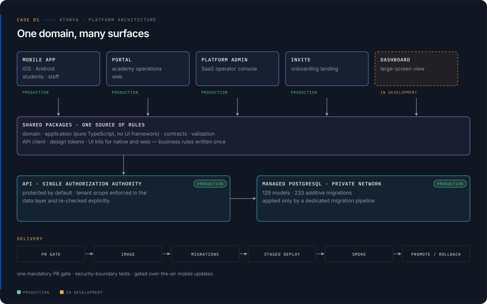
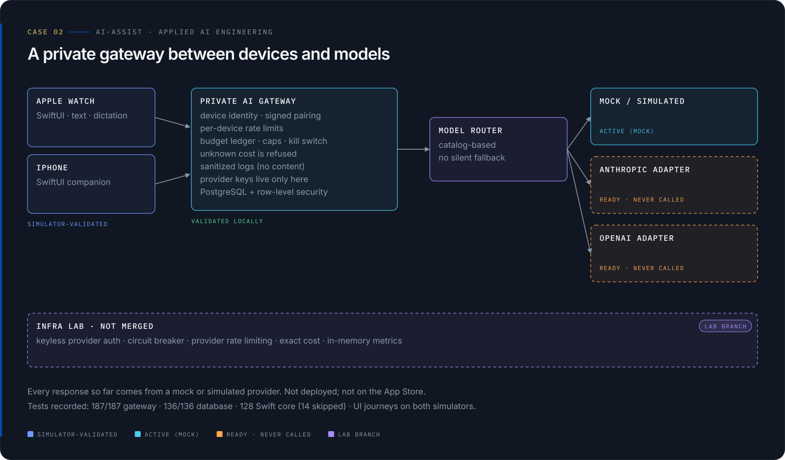
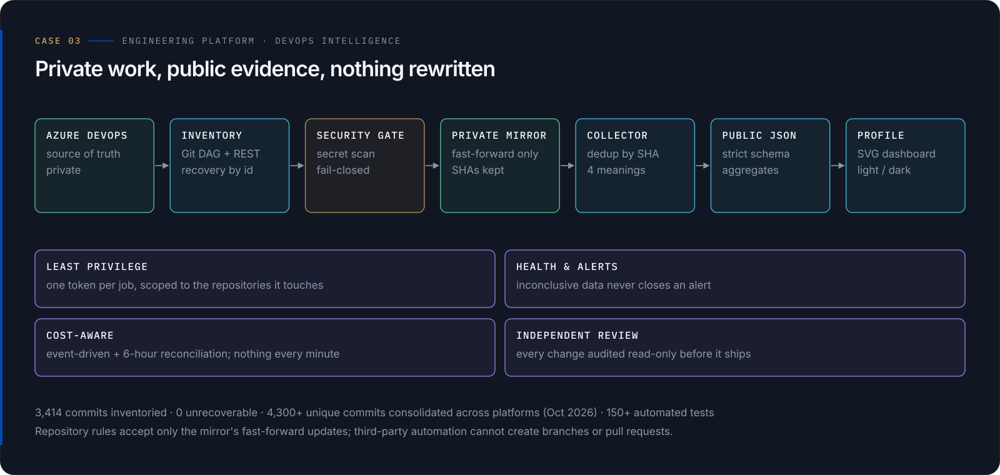
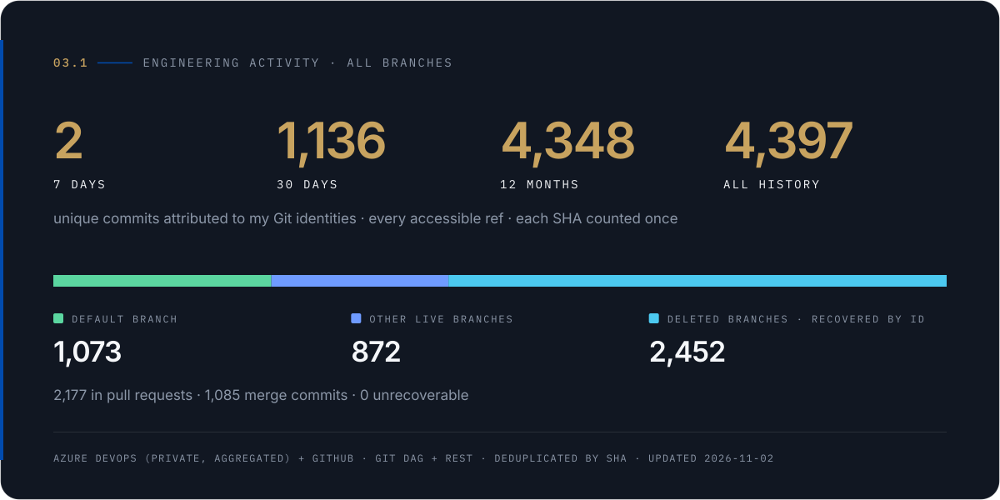
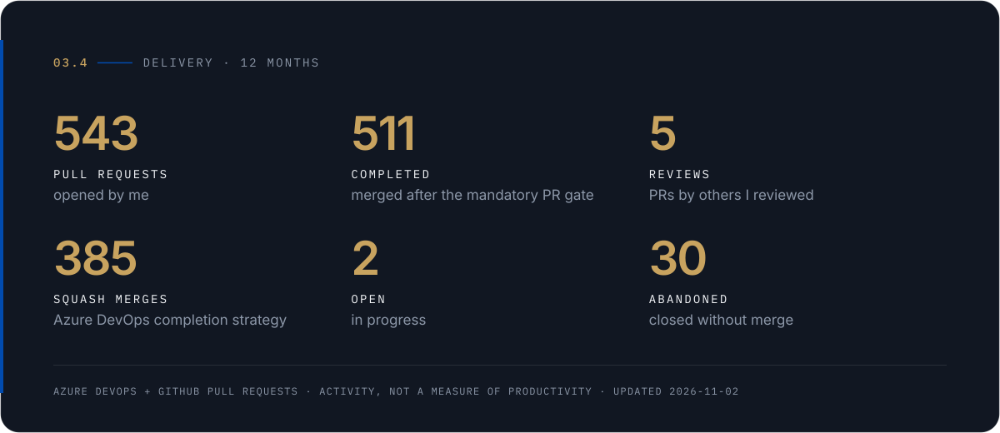
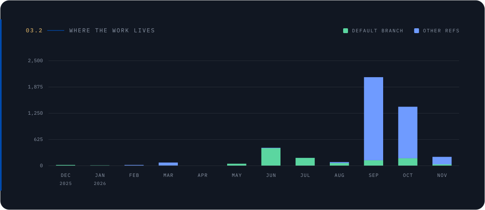
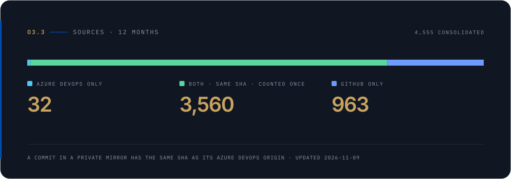
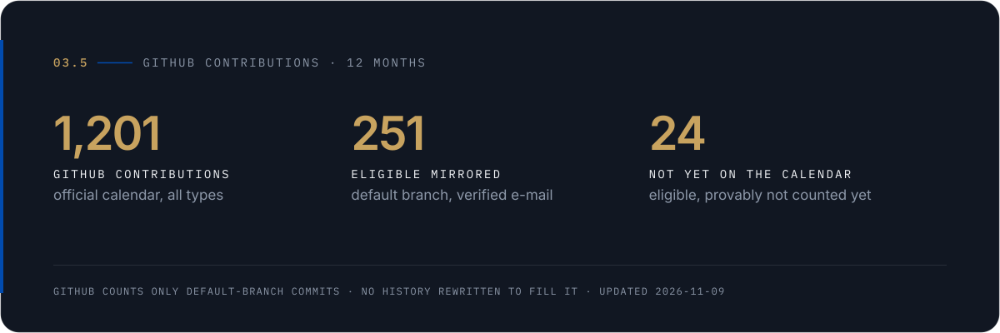

<picture>
  <source media="(prefers-color-scheme: dark)" srcset="assets/banners/hero-animated-dark.svg">
  <source media="(prefers-color-scheme: light)" srcset="assets/banners/hero-animated-light.svg">
  
</picture>

<a href="README.md">English</a> | <a href="README.pt-BR.md">Português (Brasil)</a> | <b>Español</b>

**Tech Lead · Arquitecto de Software · Cloud e IA aplicada · Sistemas distribuidos · Ingeniería de backend y plataformas.** Diseño plataformas, las llevo a producción y construyo sistemas de IA con las salvaguardas que requieren. Más de 8 años de experiencia en banca, telecomunicaciones, el área fiscal del sector público y plataformas corporativas; hoy lidero la entrega técnica en proyectos de clientes y construyo productos en [Includlab](https://includlab.com.br), mi software house.

El código fuente de los sistemas que siguen es privado. Aquí se muestran vistas de arquitectura sanitizadas, estado verificable y métricas agregadas, nunca la implementación.

## Ingeniería destacada

### 01 · Athrya — arquitectura de plataforma &nbsp;<code>PRODUCCIÓN</code>

SaaS multi-tenant para academias de jiu-jitsu: horario de clases, check-in, asistencia, progresión de cinturones, tutores y menores supervisados. Una app móvil (App Store y Google Play), portales web y una API, en producción desde octubre de 2026.
**Decisión:** el dominio, los casos de uso y los contratos viven en paquetes TypeScript compartidos de los que depende cada superficie, de modo que las reglas de negocio se escriben una sola vez; la API es la única autoridad de autorización y el alcance del tenant se aplica en la capa de datos. **Entrega:** un gate de PR obligatorio, migraciones aditivas mediante un pipeline dedicado, despliegues por etapas con rollback. Soy responsable de la arquitectura, de los controles de ingeniería, de cada merge y de las aprobaciones de go-live. → [Leer el caso](cases/athrya.es.md)

<picture>
  <source media="(prefers-color-scheme: dark)" srcset="assets/cases/athrya-architecture-dark.svg">
  <source media="(prefers-color-scheme: light)" srcset="assets/cases/athrya-architecture-light.svg">
  
</picture>

### 02 · AI-Assist — ingeniería de IA aplicada &nbsp;<code>PROTOTIPO</code>

Clientes Apple Watch e iPhone se comunican con un gateway de IA privado que concentra la identidad del dispositivo, el presupuesto y el kill switch, los límites de tasa y las claves de los proveedores; un enrutador de modelos **sin fallback silencioso** elige el adaptador.
**Estado real:** validado en simuladores con 187/187 pruebas del gateway y 136/136 de base de datos; toda respuesta hasta hoy provino de un proveedor mock o simulado; los adaptadores de Anthropic y OpenAI están listos, pero nunca se han invocado; no está desplegado ni en la App Store. → [Leer el caso](cases/ai-assist.es.md)

<picture>
  <source media="(prefers-color-scheme: dark)" srcset="assets/cases/ai-assist-architecture-dark.svg">
  <source media="(prefers-color-scheme: light)" srcset="assets/cases/ai-assist-architecture-light.svg">
  
</picture>

### 03 · Plataforma de ingeniería — DevOps intelligence &nbsp;<code>OPERATIVO</code>

La mayor parte de mi trabajo vive en repositorios privados de Azure DevOps. Esta plataforma lo hace visible **sin falsear nada**: un inventario de todo el historial, un gate de escaneo de secretos que falla en modo cerrado, un espejo privado unidireccional solo por fast-forward que conserva el SHA, el autor y la fecha de cada commit autorizado que replica (los commits excluidos por seguridad nunca se replican), y un recolector que deduplica por SHA y publica únicamente agregados mediante un schema estricto. Es el origen de los números que siguen. → [Leer el caso](cases/engineering-platform.es.md)

<picture>
  <source media="(prefers-color-scheme: dark)" srcset="assets/cases/engineering-platform-dark.svg">
  <source media="(prefers-color-scheme: light)" srcset="assets/cases/engineering-platform-light.svg">
  
</picture>

## Evidencias de ingeniería

<picture>
  <source media="(prefers-color-scheme: dark)" srcset="assets/metrics/v2/031-activity-dark.svg">
  <source media="(prefers-color-scheme: light)" srcset="assets/metrics/v2/031-activity-light.svg">
  
</picture>

<picture>
  <source media="(prefers-color-scheme: dark)" srcset="assets/metrics/v2/034-delivery-dark.svg">
  <source media="(prefers-color-scheme: light)" srcset="assets/metrics/v2/034-delivery-light.svg">
  
</picture>

<b>Dónde vive el trabajo · fuentes · contribuciones en GitHub · cómo se producen los números</b>

 

<picture>
  <source media="(prefers-color-scheme: dark)" srcset="assets/metrics/v2/032-monthly-dark.svg">
  <source media="(prefers-color-scheme: light)" srcset="assets/metrics/v2/032-monthly-light.svg">
  
</picture>

<picture>
  <source media="(prefers-color-scheme: dark)" srcset="assets/metrics/v2/033-sources-dark.svg">
  <source media="(prefers-color-scheme: light)" srcset="assets/metrics/v2/033-sources-light.svg">
  
</picture>

<picture>
  <source media="(prefers-color-scheme: dark)" srcset="assets/metrics/v2/035-contributions-dark.svg">
  <source media="(prefers-color-scheme: light)" srcset="assets/metrics/v2/035-contributions-light.svg">
  
</picture>

- Los conteos de commits se basan en identidades Git de autor verificadas, deduplicadas por SHA entre GitHub y Azure DevOps. Miden la actividad en los repositorios, no líneas escritas a mano ni la productividad individual.
- **Cuatro significados, nunca sumados:** actividad de ingeniería (cualquier rama), dónde vive el trabajo, entrega (pull requests y revisiones) y contribuciones en GitHub (lo que el propio GitHub reconoce, según sus reglas).
- **Fuentes:** API REST e historial Git de Azure DevOps y API de GitHub, recolectados en un pipeline privado; esta página recibe solo agregados ([`data/public-metrics-v2.json`](data/public-metrics-v2.json)). No se reescribió ningún historial ni se creó ningún commit para llenar el calendario.

## Tecnología y liderazgo

- **Arquitectura** sistemas distribuidos · microservicios · fronteras orientadas al dominio · integración orientada a eventos · modernización de sistemas legados · registros de decisiones
- **Backend** Java · Go · TypeScript/Node.js (NestJS) · Python · PostgreSQL · Kafka · Redis
- **Plataforma** Azure · AWS · Kubernetes · Docker · Bicep/Terraform · Azure DevOps · GitHub Actions · CI/CD · observabilidad
- **IA aplicada** agentes de IA · integración de LLM · gateways de LLM · enrutamiento multiproveedor · salvaguardas de costo y seguridad · diseño de evaluaciones
- **Liderazgo** dirección técnica hands-on · estándares de ingeniería · quality gates · gobernanza de releases · mentoría y contratación

## Contacto

[Portafolio](https://www.celiocrisologo.com.br/en) · [LinkedIn](https://www.linkedin.com/in/celioguimaraes117) · [celio@includlab.com.br](mailto:celio@includlab.com.br) · [Includlab](https://includlab.com.br) · [Links](https://linktr.ee/celio_rguimaraes)

Desde Brasil · trabajo remoto · portugués, inglés, español.

<picture>
  <source media="(prefers-color-scheme: dark)" srcset="assets/brand/signature-dark.svg">
  <source media="(prefers-color-scheme: light)" srcset="assets/brand/signature-light.svg">
  
</picture>
