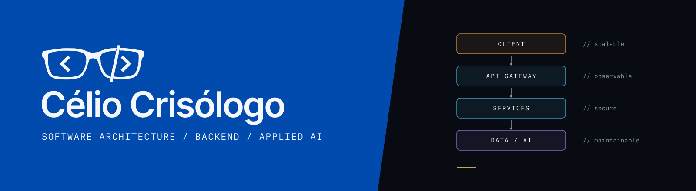
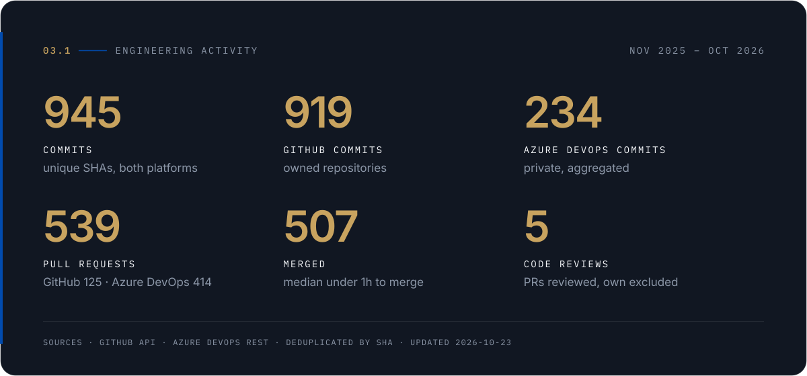
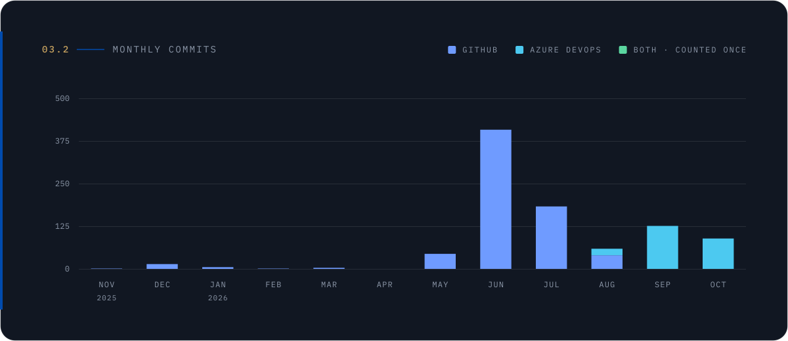
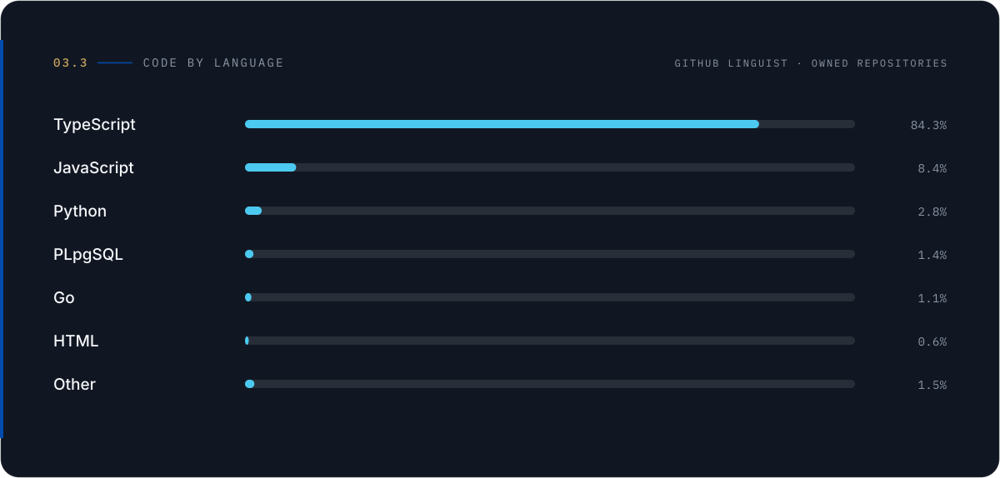

<picture>
  <source media="(prefers-color-scheme: dark)" srcset="assets/banners/hero-dark.svg">
  <source media="(prefers-color-scheme: light)" srcset="assets/banners/hero-light.svg">
  
</picture>

<a href="README.md">English</a>

**Arquiteto de Software** com foco em engenharia de backend, sistemas distribuídos, infraestrutura em nuvem e IA aplicada.

Há mais de 7 anos projeto, modernizo e opero sistemas críticos em bancos, telecom, área fiscal pública e plataformas corporativas — hands-on em Java, Go e Node.js/TypeScript, e como líder técnico definindo padrões de engenharia, quality gates e práticas de entrega para times multidisciplinares. Hoje lidero a entrega técnica em projetos de clientes e construo produtos na [Includlab](https://includlab.com.br), minha software house.

 

<picture>
  <source media="(prefers-color-scheme: dark)" srcset="assets/sections/01-engineering-focus-dark.svg">
  <source media="(prefers-color-scheme: light)" srcset="assets/sections/01-engineering-focus-light.svg">
  
</picture>

- **Arquitetura de Software** — Fronteiras orientadas a domínio, integração orientada a eventos e modernização de legados (Strangler Fig), documentadas como decisões revisáveis.
- **Backend e Sistemas Distribuídos** — Serviços transacionais para domínios regulados e de alto volume: pagamentos, crédito, fiscal, telecom.
- **Cloud e Platform Engineering** — AWS e Azure, Kubernetes, infraestrutura como código, promoção entre ambientes.
- **DevOps e CI/CD** — Pipelines com quality gates, preflight e promoção rastreável da branch até produção.
- **IA Aplicada e Automação** — Integração com LLMs e fluxos de engenharia assistidos por agentes, com decisões sob responsabilidade humana.
- **Liderança Técnica** — Padrões, revisões, governança de sprint, mentoria e contratação.

 

<picture>
  <source media="(prefers-color-scheme: dark)" srcset="assets/sections/02-technology-stack-dark.svg">
  <source media="(prefers-color-scheme: light)" srcset="assets/sections/02-technology-stack-light.svg">
  
</picture>

| | |
|---|---|
| **Linguagens** | `Java` `Go` `TypeScript` `Node.js` `Python` `C#` |
| **Backend** | `Spring Boot` `Spring Cloud` `Quarkus` `NestJS` `Express` `Prisma` `Hibernate/JPA` |
| **Cloud & Infra** | `AWS` `Azure` `Kubernetes` `Docker` `Helm` `Terraform` |
| **Dados e Mensageria** | `PostgreSQL` `Oracle` `MongoDB` `Redis` `Kafka` `RabbitMQ` |
| **DevOps e Qualidade** | `Azure DevOps` `GitHub Actions` `GitLab CI` `SonarQube` `OAuth2/OIDC` |
| **IA e Agentes** | `LLM integration` `LangChain` `Claude Code` `Codex` `Agent workflows` |

 

<picture>
  <source media="(prefers-color-scheme: dark)" srcset="assets/sections/03-engineering-activity-dark.svg">
  <source media="(prefers-color-scheme: light)" srcset="assets/sections/03-engineering-activity-light.svg">
  
</picture>

<picture>
  <source media="(prefers-color-scheme: dark)" srcset="assets/metrics/engineering-activity-dark.svg">
  <source media="(prefers-color-scheme: light)" srcset="assets/metrics/engineering-activity-light.svg">
  
</picture>

<picture>
  <source media="(prefers-color-scheme: dark)" srcset="assets/metrics/monthly-commits-dark.svg">
  <source media="(prefers-color-scheme: light)" srcset="assets/metrics/monthly-commits-light.svg">
  
</picture>

<picture>
  <source media="(prefers-color-scheme: dark)" srcset="assets/metrics/code-by-language-dark.svg">
  <source media="(prefers-color-scheme: light)" srcset="assets/metrics/code-by-language-light.svg">
  
</picture>

Como estes números são produzidos

 

- **Fontes:** APIs oficiais do GitHub (REST/GraphQL) e do Azure DevOps (REST), coletadas num pipeline privado. Os dados brutos não saem de lá; esta página recebe apenas contagens agregadas ([`data/public-metrics.json`](data/public-metrics.json)).
- **Commits:** commits de minha autoria no branch padrão de cada repositório, últimos 12 meses. Um commit presente nas duas plataformas (mesmo SHA, ex.: espelho privado) é **contado uma vez**.
- **Pull requests / reviews:** PRs que abri; reviews são PRs de outras pessoas em que votei ou enviei revisão.
- **Azure DevOps:** repositórios privados, exibidos só de forma agregada, sem nomes.
- **Linguagens:** bytes por linguagem segundo o GitHub Linguist nos meus repositórios. Mede volume de código, não proficiência.
- Contagem de commits descreve atividade, não produtividade nem qualidade.

 

<picture>
  <source media="(prefers-color-scheme: dark)" srcset="assets/sections/04-selected-work-dark.svg">
  <source media="(prefers-color-scheme: light)" srcset="assets/sections/04-selected-work-light.svg">
  
</picture>

#### Athrya &nbsp;<code>PRIVADO</code> · <code>EM DESENVOLVIMENTO</code>
Plataforma multi-tenant para academias de artes marciais: um app universal para alunos e dashboards web para a equipe.
**Decisão:** um único monorepo TypeScript em que domínio, casos de uso e contratos vivem em pacotes compartilhados por todos os apps — a regra de negócio é escrita uma vez e aplicada igualmente no mobile, na web e na API. Tenants são configuração, não forks.
`TypeScript` `Turborepo` `NestJS` `Prisma` `PostgreSQL` `Expo / React Native` `Next.js` `Zod` `Azure DevOps`

#### Includlab &nbsp;<code>EMPRESA</code> · <a href="https://includlab.com.br">includlab.com.br</a>
Minha software house: engenharia de produto, integrações e automação assistida por IA para clientes e para produtos próprios como o Athrya.

#### Engineering Activity pipeline &nbsp;<code>PRIVADO</code> · <code>NOVO</code>
O sistema por trás da seção 03. **Problema:** a maior parte do meu trabalho acontece em repositórios privados no Azure DevOps, invisíveis ao GitHub. **Decisão:** espelhamento unidirecional, apenas fast-forward, de repositórios explicitamente aprovados para repositórios privados no GitHub — SHAs, autores e datas originais preservados, scan de segredos antes de qualquer push, visibilidade reconferida antes de cada push — e um coletor que deduplica por SHA e publica só um JSON agregado e validado por schema.
`Python` `GitHub API` `Azure DevOps REST` `gitleaks` `GitHub Actions`

Trabalhos públicos anteriores: <a href="https://github.com/CelioGuimaraes117/NoteApp-master">NoteApp</a> (React, Redux, Material UI) · <a href="https://github.com/CelioGuimaraes117/themesDiscord">themesDiscord</a> (CSS).

 

<picture>
  <source media="(prefers-color-scheme: dark)" srcset="assets/sections/05-principles-dark.svg">
  <source media="(prefers-color-scheme: light)" srcset="assets/sections/05-principles-light.svg">
  
</picture>

1. **Simplicidade primeiro.** A melhor arquitetura é a menor que sobrevive aos próximos dois anos de requisitos.
2. **Decisões verificáveis.** Toda escolha relevante tem registro, motivo e um jeito de saber se estava errada.
3. **Escala se projeta.** Fronteiras, back-pressure e posse dos dados vêm antes da infraestrutura.
4. **Observável por padrão.** Se não pode ser medido em produção, não está pronto.
5. **Seguro por construção.** Menor privilégio, segredos fora do código, ameaças avaliadas no design.
6. **Manutenibilidade é requisito.** O código é lido pelo próximo engenheiro muito mais vezes do que é escrito.
7. **Clareza acima de esperteza.** No código, nos documentos e na conversa com o negócio.

 

<picture>
  <source media="(prefers-color-scheme: dark)" srcset="assets/sections/06-contact-dark.svg">
  <source media="(prefers-color-scheme: light)" srcset="assets/sections/06-contact-light.svg">
  
</picture>

[LinkedIn](https://www.linkedin.com/in/celioguimaraes117) · [celio@includlab.com.br](mailto:celio@includlab.com.br) · [Includlab](https://includlab.com.br) · [Links](https://linktr.ee/celio_rguimaraes)

No Brasil · trabalho remoto · português, inglês, espanhol.

 

<picture>
  <source media="(prefers-color-scheme: dark)" srcset="assets/brand/signature-dark.svg">
  <source media="(prefers-color-scheme: light)" srcset="assets/brand/signature-light.svg">
  
</picture>
