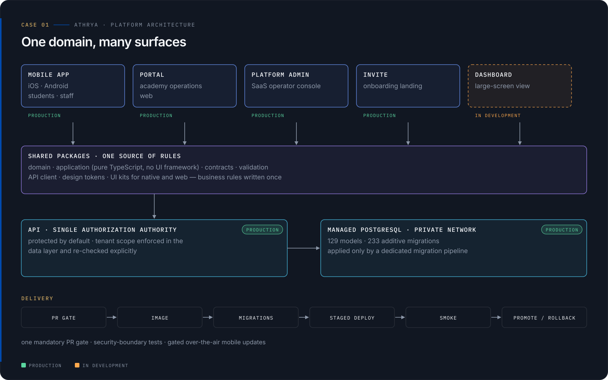
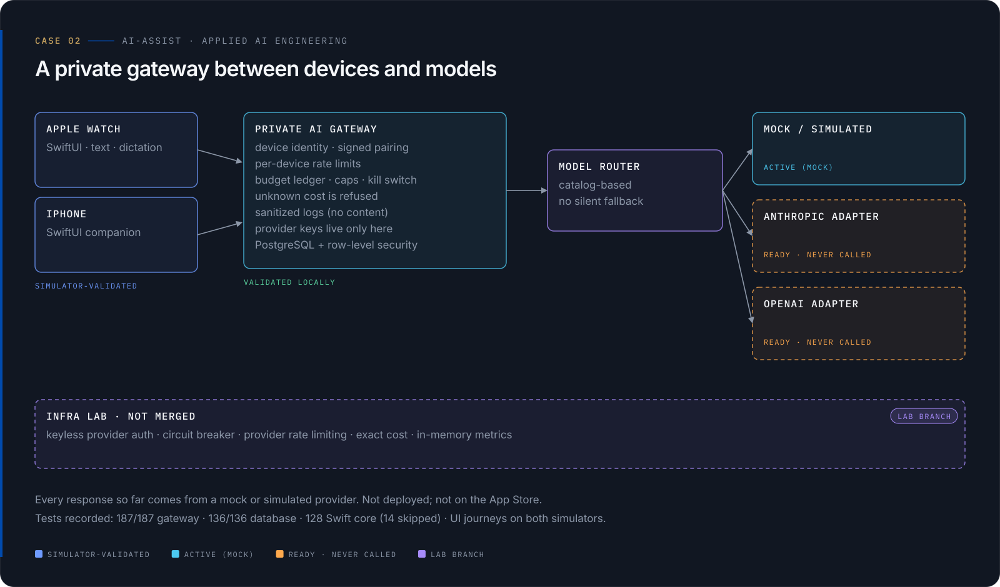
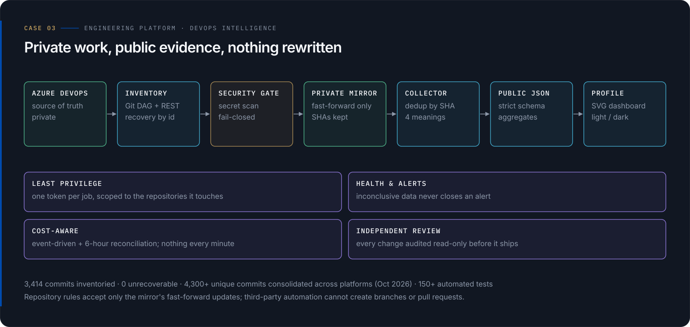
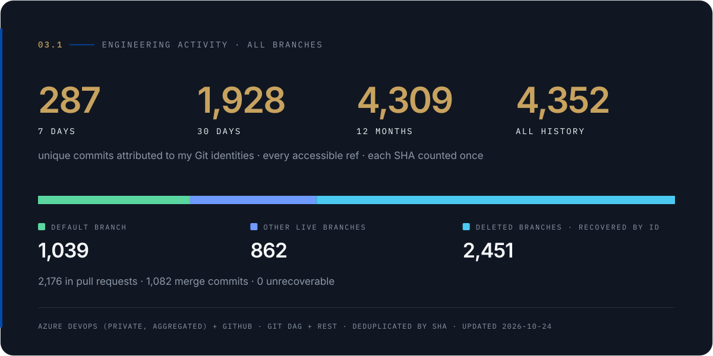
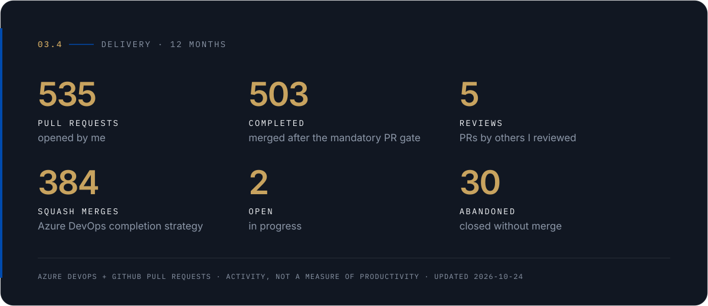
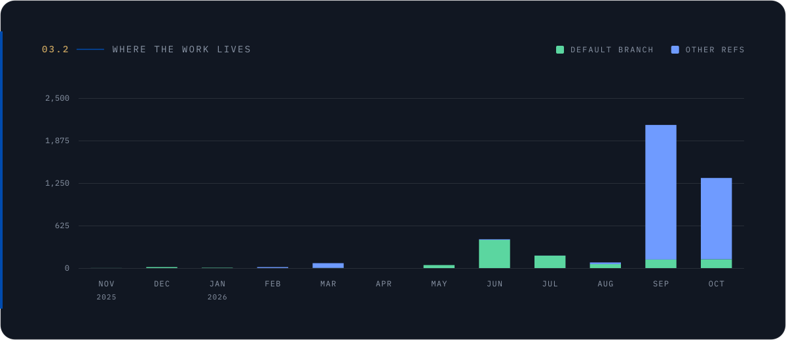
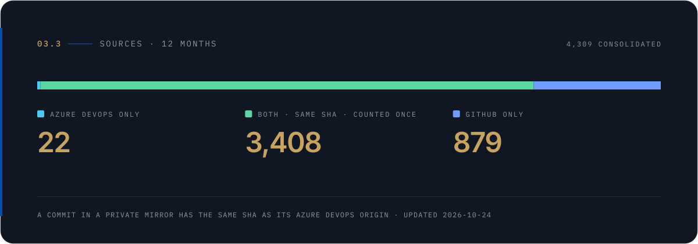
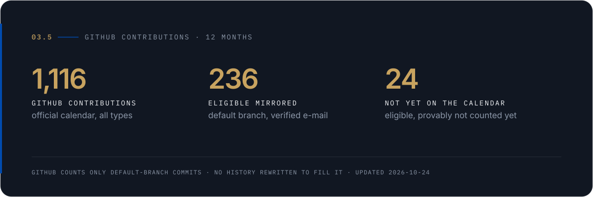

<picture>
  <source media="(prefers-color-scheme: dark)" srcset="assets/banners/hero-animated-dark.svg">
  <source media="(prefers-color-scheme: light)" srcset="assets/banners/hero-animated-light.svg">
  
</picture>

<a href="README.md">English</a>

**Arquiteto de Software · Tech Lead · Engenharia de IA Aplicada.** Projeto plataformas, levo-as à produção e construo sistemas de IA com as salvaguardas que eles exigem. Mais de 7 anos em bancos, telecom, área fiscal pública e plataformas corporativas; hoje lidero a entrega técnica em projetos de clientes e construo produtos na [Includlab](https://includlab.com.br), minha software house.

O código-fonte dos sistemas abaixo é privado. Aqui aparecem visões de arquitetura sanitizadas, estado verificável e métricas agregadas — nunca a implementação.

## Engenharia em destaque

### 01 · Athrya — arquitetura de plataforma &nbsp;<code>PRODUÇÃO</code>

SaaS multi-tenant para academias de jiu-jitsu: grade de aulas, check-in, frequência, progressão de faixas, responsáveis e menores supervisionados. Um app mobile (App Store e Google Play), portais web e uma API, em produção desde outubro de 2026.
**Decisão:** domínio, casos de uso e contratos vivem em pacotes TypeScript compartilhados dos quais toda superfície depende, então as regras de negócio são escritas uma vez; a API é a única autoridade de autorização e o escopo do tenant é aplicado na camada de dados. **Entrega:** um gate de PR obrigatório, migrations aditivas por pipeline dedicado, deploys em etapas com rollback. Sou responsável pela arquitetura, pelos controles de engenharia, por cada merge e pelas aprovações de go-live. → [Ler o case](cases/athrya.pt-BR.md)

<picture>
  <source media="(prefers-color-scheme: dark)" srcset="assets/cases/athrya-architecture-dark.svg">
  <source media="(prefers-color-scheme: light)" srcset="assets/cases/athrya-architecture-light.svg">
  
</picture>

### 02 · AI-Assist — engenharia de IA aplicada &nbsp;<code>PROTÓTIPO</code>

Clientes Apple Watch e iPhone conversam com um gateway de IA privado que concentra identidade do dispositivo, orçamento e kill switch, limites de taxa e as chaves dos provedores; um roteador de modelos **sem fallback silencioso** escolhe o adaptador.
**Estado real:** validado em simuladores com 187/187 testes do gateway e 136/136 de banco; toda resposta até hoje veio de um provedor simulado; os adaptadores Anthropic e OpenAI estão prontos, mas nunca foram chamados; não está implantado nem na App Store. → [Ler o case](cases/ai-assist.pt-BR.md)

<picture>
  <source media="(prefers-color-scheme: dark)" srcset="assets/cases/ai-assist-architecture-dark.svg">
  <source media="(prefers-color-scheme: light)" srcset="assets/cases/ai-assist-architecture-light.svg">
  
</picture>

### 03 · Plataforma de engenharia — DevOps intelligence &nbsp;<code>OPERACIONAL</code>

A maior parte do meu trabalho vive em repositórios privados no Azure DevOps. Esta plataforma o torna visível **sem falsificar nada**: inventário de todo o histórico, um gate de varredura de segredos que falha fechado, um espelho privado unidirecional só por fast-forward que preserva cada SHA, autor e data, e um coletor que deduplica por SHA e publica apenas agregados com schema estrito. É a origem dos números abaixo. → [Ler o case](cases/engineering-platform.pt-BR.md)

<picture>
  <source media="(prefers-color-scheme: dark)" srcset="assets/cases/engineering-platform-dark.svg">
  <source media="(prefers-color-scheme: light)" srcset="assets/cases/engineering-platform-light.svg">
  
</picture>

## Evidências de engenharia

<picture>
  <source media="(prefers-color-scheme: dark)" srcset="assets/metrics/v2/031-activity-dark.svg">
  <source media="(prefers-color-scheme: light)" srcset="assets/metrics/v2/031-activity-light.svg">
  
</picture>

<picture>
  <source media="(prefers-color-scheme: dark)" srcset="assets/metrics/v2/034-delivery-dark.svg">
  <source media="(prefers-color-scheme: light)" srcset="assets/metrics/v2/034-delivery-light.svg">
  
</picture>

<b>Onde o trabalho vive · fontes · contribuições no GitHub · como os números são produzidos</b>

 

<picture>
  <source media="(prefers-color-scheme: dark)" srcset="assets/metrics/v2/032-monthly-dark.svg">
  <source media="(prefers-color-scheme: light)" srcset="assets/metrics/v2/032-monthly-light.svg">
  
</picture>

<picture>
  <source media="(prefers-color-scheme: dark)" srcset="assets/metrics/v2/033-sources-dark.svg">
  <source media="(prefers-color-scheme: light)" srcset="assets/metrics/v2/033-sources-light.svg">
  
</picture>

<picture>
  <source media="(prefers-color-scheme: dark)" srcset="assets/metrics/v2/035-contributions-dark.svg">
  <source media="(prefers-color-scheme: light)" srcset="assets/metrics/v2/035-contributions-light.svg">
  
</picture>

- As contagens de commits se baseiam em identidades Git de autor verificadas, deduplicadas por SHA entre GitHub e Azure DevOps. Elas medem atividade nos repositórios, não linhas escritas manualmente nem produtividade individual.
- **Quatro significados, nunca somados:** atividade de engenharia (qualquer branch), onde o trabalho vive, entrega (pull requests e revisões) e contribuições no GitHub (o que o próprio GitHub reconhece, pelas regras dele).
- **Fontes:** API REST e histórico Git do Azure DevOps e API do GitHub, coletados num pipeline privado; esta página recebe apenas agregados ([`data/public-metrics-v2.json`](data/public-metrics-v2.json)). Nenhum histórico foi reescrito e nenhum commit foi criado para preencher o calendário.

## Tecnologia e liderança

**Arquitetura** fronteiras orientadas a domínio · integração orientada a eventos · modernização de legado · registros de decisão
**Backend** Java · Go · TypeScript/Node.js (NestJS) · Python · PostgreSQL · Kafka · Redis
**Plataforma** Azure · AWS · Kubernetes · Docker · Bicep/Terraform · Azure DevOps · GitHub Actions
**IA aplicada** gateways de LLM · roteamento multi-provedor · salvaguardas de custo e segurança · desenho de avaliações
**Liderança** padrões de engenharia · quality gates · governança de release · mentoria e contratação

## Contato

[LinkedIn](https://www.linkedin.com/in/celioguimaraes117) · [celio@includlab.com.br](mailto:celio@includlab.com.br) · [Includlab](https://includlab.com.br) · [Links](https://linktr.ee/celio_rguimaraes)

No Brasil · trabalho remoto · português, inglês, espanhol.

<picture>
  <source media="(prefers-color-scheme: dark)" srcset="assets/brand/signature-dark.svg">
  <source media="(prefers-color-scheme: light)" srcset="assets/brand/signature-light.svg">
  
</picture>
