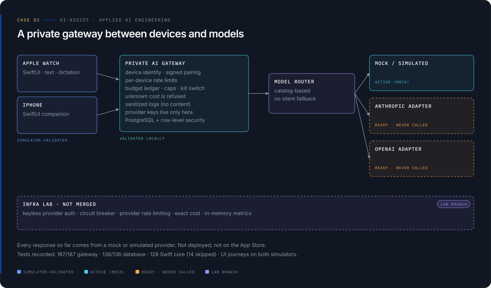
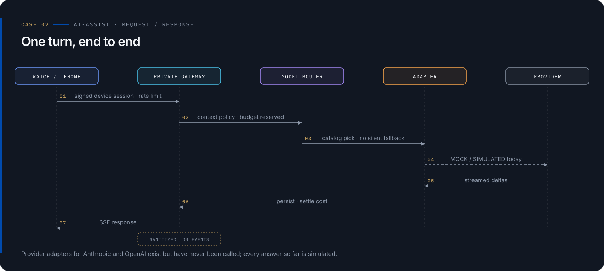
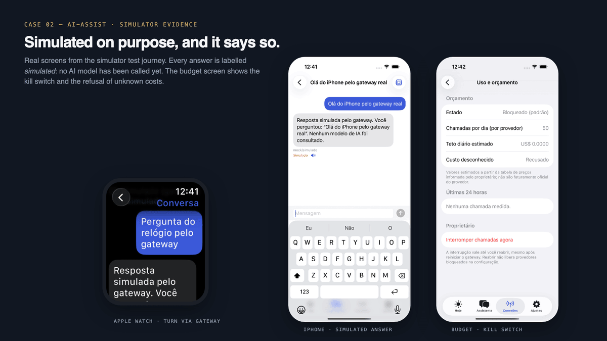

# AI-Assist: un gateway de IA privado para Apple Watch e iPhone

<p align="right"><a href="ai-assist.en.md">English</a> | <a href="ai-assist.pt-BR.md">Português (Brasil)</a> | <b>Español</b></p>
## Contexto

AI-Assist es un proyecto personal: un asistente para Apple Watch, con una app complementaria para iPhone, que accede a modelos de lenguaje únicamente a través de un gateway que yo controlo. Sigue un roadmap de varias oleadas. Este caso cubre las cuatro primeras (fundación, clientes Apple, el gateway con persistencia y sincronización, y la capa de proveedores), que se cerraron con una batería de pruebas congelada, una reconciliación escrita y una revisión independiente.

## Desafío

- Permitir que un reloj use proveedores de IA sin que ningún dispositivo guarde jamás una clave de proveedor.
- Mantener el gasto acotado y que el dueño pueda detenerlo.
- Enrutar entre modelos sin ocultar qué modelo respondió.
- Sincronizar la memoria personal entre dispositivos manteniendo parte del contexto fuera de la IA externa.

## Mi rol

Dueño, arquitecto e ingeniero del proyecto: alcance del producto, arquitectura, los 14 registros de decisiones de arquitectura (ADR), implementación en Swift y TypeScript, esquema de la base de datos y políticas de row-level security, estrategia de pruebas, herramientas de seguridad y proceso de revisión.

## Arquitectura

<picture>
  <source media="(prefers-color-scheme: dark)" srcset="../assets/cases/ai-assist-architecture-dark.svg">
  <source media="(prefers-color-scheme: light)" srcset="../assets/cases/ai-assist-architecture-light.svg">
  
</picture>

<picture>
  <source media="(prefers-color-scheme: dark)" srcset="../assets/cases/ai-assist-flow-dark.svg">
  <source media="(prefers-color-scheme: light)" srcset="../assets/cases/ai-assist-flow-light.svg">
  
</picture>


```
Apple Watch / iPhone
  → apps cliente (SwiftUI, núcleo Swift compartido, cero dependencias Swift externas)
  → gateway de IA privado (TypeScript en Node.js, sin framework web)
  → enrutador de modelos (basado en catálogo, consciente del ciclo de vida y del contexto)
  → adaptadores de modelo (mock, simulado, Anthropic, OpenAI)
  → proveedores (hasta hoy, solo han respondido proveedores mock y simulados)
```

Un turno: el cliente se autentica con una sesión de dispositivo; el gateway rechaza orígenes inesperados y aplica límites de tamaño, rate limit por dispositivo y verificación de alcance; la generación corre dentro del contexto de row-level security del dispositivo; se aplica la política de contexto; el enrutador resuelve el modelo; la memoria y los resúmenes entran al prompt como datos, fuera de la instrucción de sistema; el ledger reserva presupuesto; el adaptador sale por una allowlist de egress con URL exactas; los deltas se persisten y se transmiten; la reserva se liquida con el uso registrado.

Preocupaciones transversales:

- **Identidad y emparejamiento de dispositivos.** Claves P-256 por dispositivo (Secure Enclave cuando está disponible), aprobación firmada del dueño para el emparejamiento, sesiones cortas con hash y una revocación que también cierra los streams abiertos.
- **Secretos en el servidor.** Las claves de proveedor existen solo en el gateway; la interfaz del cliente no tiene parámetro de clave. La credencial del dispositivo permanece en el Keychain, vinculada a ese dispositivo.
- **Ledger de presupuesto y kill switch.** Ledger durable de reserva y liquidación, topes diarios y un kill switch persistente del dueño. Los costos son estimaciones a partir de una tabla de precios mantenida por el dueño.
- **Rate limiting.** Límites por dispositivo más un limitador separado para las rutas públicas.
- **Logs sanitizados.** Allowlist de campos y redacción de secretos; el contenido de las conversaciones nunca se registra.
- **Persistencia con row-level security.** PostgreSQL con row-level security, triggers de auditoría y migraciones versionadas.
- **Sincronización.** Feed de cambios con cursores firmados e importación idempotente.

## Decisiones y trade-offs

- **Sin fallback silencioso.** El fallback existe solo como regla explícita de catálogo, solo antes del primer token, y los catálogos entregados no definen ninguno.
- **Claves solo en el gateway.** Un componente más que operar, a cambio de dispositivos que nunca llevan credenciales de proveedor.
- **Se rechaza el costo desconocido.** Un modelo sin precio registrado no puede ejecutarse. La IA real exige además dos candados (política de activación y presupuesto), junto con catálogo, precio, tope y kill switch.
- **Una única dependencia de runtime.** El gateway no tiene framework web y depende solo del driver de PostgreSQL, lo que mantiene reducida la superficie de la cadena de suministro.
- **Apple nativo.** SwiftUI para watchOS e iOS, sin framework multiplataforma.
- **Consentimiento separado.** Sincronizar y enviar contenido a la IA externa son permisos distintos. El contexto profesional de terceros nunca se envía a la IA externa.

## Prácticas de ingeniería

- **14 ADR**, desde Apple nativo y el gateway privado hasta la política de credenciales, la identidad por dispositivo y la activación de proveedores y el presupuesto.
- **Batería de pruebas.** Un script local ejecuta todas las suites, con pruebas de base de datos sobre clústeres PostgreSQL efímeros. Un bloqueo de red impide las llamadas salientes durante las pruebas.
- **Rondas de revisión independiente.** El trabajo fue revisado de forma independiente en varias rondas; la reverificación final, estática, terminó con reservas no bloqueantes, registradas en el registro de riesgos residuales.
- **Herramientas de seguridad.** Escaneo de secretos, análisis estático con 22 reglas propias probadas, auditoría de dependencias y una verificación offline de la cadena de suministro.

## Resultados

<picture>
  <source media="(prefers-color-scheme: dark)" srcset="../assets/cases/ai-assist-evidence-dark.png">
  <source media="(prefers-color-scheme: light)" srcset="../assets/cases/ai-assist-evidence-light.png">
  
</picture>


Resultados de las pruebas, tal como se registraron en la batería final:

| Suite | Resultado |
|---|---|
| Unitarias del gateway | 187/187 aprobadas |
| Base de datos (PostgreSQL efímero) | 136/136 aprobadas |
| Núcleo Swift | 128 pruebas, 14 omitidas, 0 fallos |
| App iOS hospedada | 9 aprobadas |
| UI de iPhone y Watch | aprobadas en la ejecución final (la suite del Watch falló una vez por un problema de la propia prueba y pasó al reejecutarse) |
| Swift ↔ gateway | 5 de integración + 7 end-to-end aprobadas |

Un recorrido conjunto de UI también ejecutó ambos simuladores contra un gateway local real y el proveedor mock, desde el emparejamiento hasta la conversación, el presupuesto y la edición de la memoria. El diseño está registrado en 14 ADR.

## Estado actual

| Área | Estado |
|---|---|
| App de watchOS y complemento iOS | Implementado; validado en simulador |
| Gateway, identidad y emparejamiento, ledger de presupuesto, kill switch, rate limiting, logs | Implementado; validado localmente |
| Persistencia con row-level security, sincronización, memoria | Implementado; validado localmente |
| Enrutador de modelos, adaptadores mock y simulado | Implementado; validado offline |
| Adaptadores de Anthropic y OpenAI | Implementado; bloqueado, nunca invocado |
| Autenticación de proveedor sin claves, circuit breaker, rate limiting por proveedor, costo exacto | Solo en el laboratorio (copia separada, aún no reconciliada con la línea principal) |
| Notificaciones, datos de salud, widgets y complicaciones, motor de políticas, herramientas para desarrolladores | Planificado |
| Pipeline de CI, hosting en la nube | Planificado (solo diseño y plantillas, nunca aplicados) |

## Limitaciones

- Prototipo. Todas las respuestas de proveedores hasta ahora provinieron de proveedores mock o simulados; los adaptadores reales de Anthropic y OpenAI existen, pero nunca se han invocado.
- Sin App Store ni TestFlight. No desplegado.
- Sin app para macOS.
- Sin evaluaciones de LLM; solo pruebas deterministas y offline de prompt injection.
- Sin CI; la batería se ejecuta localmente.
- Aceptación en dispositivos físicos pendiente.
- El trabajo del infra-lab (autenticación de proveedor sin claves, circuit breaker, rate limiting por proveedor, costo exacto) es una copia de laboratorio separada, aún no reconciliada con la línea principal, sin ejecución de pruebas registrada tras esos cambios.
- Los riesgos residuales se llevan en un registro propio y deben revisarse de nuevo antes de cualquier despliegue remoto.

## Lecciones aprendidas

- El rechazo como comportamiento por defecto es verificable con pruebas: la activación real está bloqueada por diseño, y se espera que la verificación de activación falle.
- La validación offline no es validación en vivo, por eso la oleada de proveedores se registra como "validada offline, API real pendiente".
- Hay que reportar la ejecución, no solo el resultado: se documenta la reejecución del Watch.
- Una copia de laboratorio separada protegió la línea principal, al precio de una reconciliación pendiente.

## Lo que intencionalmente no se muestra

Código fuente, configuración, endpoints, credenciales, fixtures de pruebas, transcripciones de revisión, prompts, logs y detalles del entorno. Las capturas de pantalla, si las hay, usan datos sintéticos del simulador.

---
<sub>Caso de estudio sanitizado. El código fuente es privado; esta página muestra únicamente arquitectura, decisiones y estado verificable. · <a href="../README.es.md">Volver al perfil</a></sub>
