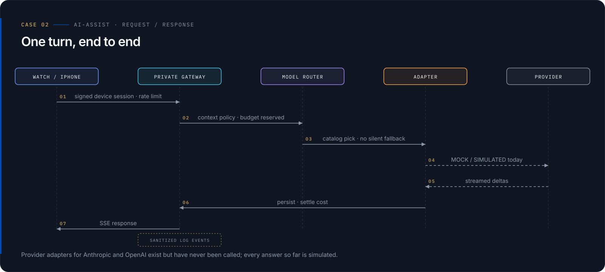
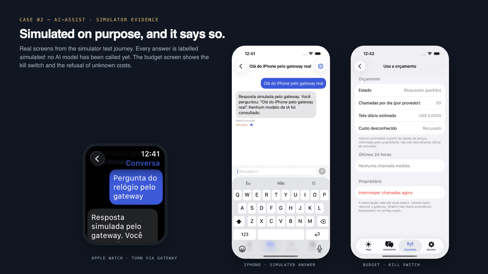

# AI-Assist: um gateway de IA privado para Apple Watch e iPhone

<p align="right"><sub><a href="ai-assist.en.md">English</a></sub></p>
## Contexto

AI-Assist é um projeto pessoal: um assistente para Apple Watch, com um app companheiro para iPhone, que acessa modelos de linguagem apenas por meio de um gateway que eu controlo. Este case cobre as quatro primeiras ondas do roadmap (fundação, clientes Apple, gateway com persistência e sincronização, e camada de provedores), encerradas com uma bateria de testes congelada, uma reconciliação escrita e uma revisão independente.

## Desafio

- Permitir que um relógio use provedores de IA sem que nenhum dispositivo jamais guarde uma chave de provedor.
- Manter o gasto limitado e interrompível pelo dono.
- Rotear entre modelos sem esconder qual modelo respondeu.
- Sincronizar memória pessoal entre dispositivos mantendo parte do contexto longe de IA externa.

## Meu papel

Dono, arquiteto e engenheiro do projeto: escopo, arquitetura, os 14 ADRs, implementação em Swift e TypeScript, esquema do banco e políticas de row-level security, estratégia de testes, ferramentas de segurança e processo de revisão.

## Arquitetura

<picture>
  <source media="(prefers-color-scheme: dark)" srcset="../assets/cases/ai-assist-architecture-dark.svg">
  <source media="(prefers-color-scheme: light)" srcset="../assets/cases/ai-assist-architecture-light.svg">
  
</picture>

<picture>
  <source media="(prefers-color-scheme: dark)" srcset="../assets/cases/ai-assist-flow-dark.svg">
  <source media="(prefers-color-scheme: light)" srcset="../assets/cases/ai-assist-flow-light.svg">
  
</picture>


```
Apple Watch / iPhone
  → apps cliente (SwiftUI, núcleo Swift compartilhado, zero dependências Swift externas)
  → gateway de IA privado (TypeScript em Node.js, sem framework web)
  → roteador de modelos (baseado em catálogo, ciente de ciclo de vida e contexto)
  → adaptadores de modelo (mock, simulado, Anthropic, OpenAI)
  → provedores (até hoje, só provedores mock e simulados responderam)
```

Um turno: o cliente se autentica com sessão de dispositivo; o gateway rejeita origens inesperadas e aplica limites de tamanho, rate limit por dispositivo e verificação de escopo; a geração roda no contexto de row-level security do dispositivo; aplica-se a política de contexto; o roteador resolve o modelo; memória e resumos entram no prompt como dados, fora da instrução de sistema; o ledger reserva orçamento; o adaptador sai por uma allowlist de egress com URLs exatas; os deltas são persistidos e transmitidos; a reserva é liquidada com o uso real.

Preocupações transversais:

- **Identidade e pareamento de dispositivos.** Chaves P-256 por dispositivo (Secure Enclave quando disponível), aprovação assinada do dono, sessões curtas com hash e revogação que encerra streams abertos.
- **Segredos no servidor.** Chaves de provedor existem só no gateway; a interface do cliente não tem parâmetro de chave. A credencial do dispositivo fica no Keychain, presa ao aparelho.
- **Ledger de orçamento e kill switch.** Ledger durável de reserva e liquidação, tetos diários e kill switch persistente. Custos são estimativas de uma tabela de preços mantida pelo dono.
- **Rate limiting.** Limites por dispositivo mais um limitador separado para rotas públicas.
- **Logs sanitizados.** Allowlist de campos e redação de segredos; o conteúdo das conversas nunca é registrado.
- **Persistência com row-level security.** PostgreSQL com triggers de auditoria e migrações versionadas.
- **Sincronização.** Feed de mudanças com cursores assinados e importação idempotente.

## Decisões e trade-offs

- **Sem fallback silencioso.** Fallback existe só como regra explícita de catálogo, só antes do primeiro token, e os catálogos entregues não definem nenhuma.
- **Chaves só no gateway.** Um componente a mais para operar, em troca de dispositivos que nunca carregam credenciais de provedor.
- **Custo desconhecido é recusado.** Modelo sem preço cadastrado não roda. IA real exige duas travas (política de ativação e orçamento), além de catálogo, preço, teto e kill switch.
- **Uma única dependência de runtime.** Sem framework web; só o driver do PostgreSQL, reduzindo a superfície de cadeia de suprimentos.
- **Apple nativo.** SwiftUI para watchOS e iOS, sem framework multiplataforma.
- **Consentimento separado.** Sincronizar e enviar conteúdo a IA externa são permissões distintas. Contexto profissional de terceiros nunca é enviado a IA externa.

## Práticas de engenharia

- **14 ADRs**, de Apple nativo e gateway privado a política de credenciais e ativação de provedores.
- **Bateria de testes.** Um script local roda todas as suítes, com testes de banco em clusters PostgreSQL efêmeros. Uma trava de rede bloqueia chamadas de saída durante os testes.
- **Rodadas de revisão independente.** O trabalho foi revisado de forma independente em várias rodadas; a reverificação final, estática, terminou com ressalvas não bloqueantes, registradas no registro de riscos residuais.
- **Ferramentas de segurança.** Varredura de segredos, análise estática com 22 regras próprias testadas, auditoria de dependências e checagem offline de cadeia de suprimentos.

## Resultados

<picture>
  <source media="(prefers-color-scheme: dark)" srcset="../assets/cases/ai-assist-evidence-dark.png">
  <source media="(prefers-color-scheme: light)" srcset="../assets/cases/ai-assist-evidence-light.png">
  
</picture>


Resultados de teste conforme registrados na bateria final:

| Suíte | Resultado |
|---|---|
| Unitários do gateway | 187/187 passando |
| Banco (PostgreSQL efêmero) | 136/136 passando |
| Núcleo Swift | 128 testes, 14 ignorados, 0 falhas |
| App iOS hospedado | 9 passando |
| UI de iPhone e Watch | passando na execução final (o Watch falhou uma vez por causa do próprio teste e passou na reexecução) |
| Swift ↔ gateway | 5 de integração + 7 ponta a ponta passando |

Uma jornada de UI conjunta rodou os dois simuladores contra um gateway local real e o provedor mock, do pareamento à edição de memória. O design está em 14 ADRs.

## Status atual

| Área | Status |
|---|---|
| App watchOS e companheiro iOS | Implementado; validado em simulador |
| Gateway, identidade e pareamento, ledger de orçamento, kill switch, rate limiting, logs | Implementado; validado localmente |
| Persistência com row-level security, sincronização, memória | Implementado; validado localmente |
| Roteador de modelos, adaptadores mock e simulados | Implementado; validado offline |
| Adaptadores Anthropic e OpenAI | Implementado; bloqueado, nunca chamado |
| Autenticação de provedor sem chave, circuit breaker, rate limiting por provedor, custo exato | Só no laboratório (cópia separada, ainda não reconciliada com a linha principal) |
| Notificações, dados de saúde, widgets e complicações, motor de políticas, ferramentas de desenvolvedor | Planejado |
| Pipeline de CI, hospedagem em nuvem | Planejado (apenas desenho e templates, nunca aplicados) |

## Limitações

- Protótipo. Todas as respostas de provedor até agora vieram de provedores mock ou simulados; os adaptadores reais de Anthropic e OpenAI existem, mas nunca foram chamados.
- Sem App Store ou TestFlight. Não implantado.
- Sem app para macOS.
- Sem avaliações de LLM; apenas testes determinísticos e offline de prompt injection.
- Sem CI; a bateria roda localmente.
- Aceite em dispositivos físicos pendente.
- O infra-lab (autenticação de provedor sem chave, circuit breaker, rate limiting por provedor, custo exato) é uma cópia de laboratório separada, ainda não reconciliada com a linha principal, sem execução de testes registrada após as mudanças.
- Os riscos residuais ficam num registro próprio e precisam ser revisados de novo antes de qualquer implantação remota.

## Lições aprendidas

- Recusa como padrão é testável: a ativação real é bloqueada por design, e a verificação de ativação deve falhar.
- Validação offline não é validação ao vivo, por isso a onda de provedores está registrada como "validada offline, API real pendente".
- Registrar a execução, não só o resultado: a reexecução do Watch está documentada.
- Uma cópia de laboratório separada protegeu a linha principal, ao custo de uma reconciliação pendente.

## O que não é mostrado de propósito

Código-fonte, configuração, endpoints, credenciais, fixtures, transcrições de revisão, prompts, logs e detalhes de ambiente. Capturas de tela, se houver, usam dados sintéticos.

---
<sub>Estudo de caso sanitizado. O código-fonte é privado; esta página mostra apenas arquitetura, decisões e estado verificável. · <a href="../README.pt-BR.md">Voltar ao perfil</a></sub>
