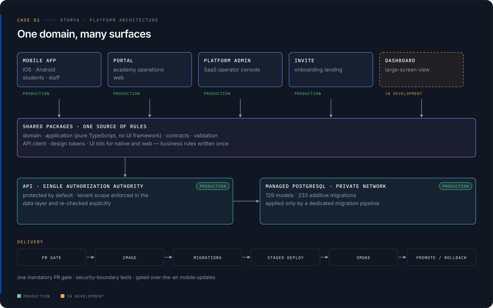
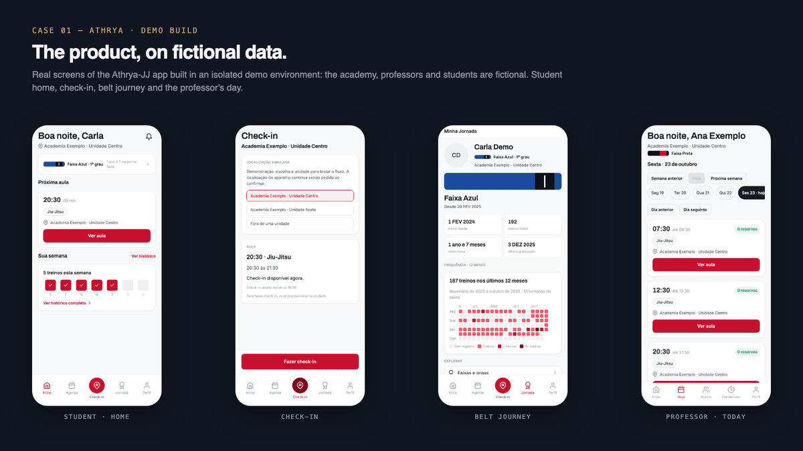

# Athrya — una plataforma multi-tenant para academias de artes marciales

<a href="athrya.en.md">English</a> | <a href="athrya.pt-BR.md">Português (Brasil)</a> | <b>Español</b>

## Contexto

Las academias de jiu-jitsu viven de clases recurrentes, asistencia, progresión de cinturones y familias, ya que muchos alumnos son menores de edad. Muchas funcionan en red, de modo que una misma persona puede entrenar en una sede y enseñar o administrar en otra. Athrya es un SaaS multi-tenant pensado para ese escenario. Cubre el horario de clases, el check-in, la asistencia y sus correcciones, el seguimiento de graduaciones, el currículo, las invitaciones, los tutores y los menores supervisados (de 13 a 17 años) y la administración de cobros de la academia.

## Desafío

- **Muchos roles, una sola base de datos.** Alumnos, profesores, gerentes, recepción y operadores de la plataforma necesitan accesos distintos. El acceso depende de la sede en la que la persona esté actuando.
- **Datos de menores.** Los tutores legales, las cuentas supervisadas y la transición a la mayoría de edad deben modelarse de forma explícita y tratarse con cuidado.
- **Calidad que no dependa de la memoria.** La red de seguridad tenía que ser automatizada y obligatoria, no depender de convenciones.
- **Un lanzamiento real.** La revisión de las tiendas, la infraestructura de producción, las migraciones y el hypercare debían funcionar en una fecha fija de go-live, en octubre de 2026.

## Mi rol

Fui el arquitecto e ingeniero líder, responsable de la arquitectura, la implementación, la calidad y el release del producto.
Cerca del 99 % de los commits del repositorio del producto entre agosto y octubre de 2026 se atribuyen a mis identidades Git;
el resto proviene de otros tres colaboradores y de una identidad de automatización.

- Definí el modelo de dominio, las decisiones de arquitectura (13 ADR y un registro de 22 decisiones) y los criterios de aceptación.
- Establecí los controles de ingeniería que todo cambio debía superar: un gate de PR obligatorio, una política de migraciones y pruebas de fronteras de seguridad.
- Las políticas de rama de Azure DevOps en `main` exigen que todo pull request supere el build bloqueante de validación de PR, esté vinculado a un work item y se integre mediante squash.
- Me encargué de cada merge y firmé las aprobaciones técnica, de producto y de operaciones para el go-live.

## Arquitectura

<picture>
  <source media="(prefers-color-scheme: dark)" srcset="../assets/cases/athrya-architecture-dark.svg">
  <source media="(prefers-color-scheme: light)" srcset="../assets/cases/athrya-architecture-light.svg">
  
</picture>

Un monorepo TypeScript (npm workspaces y Turborepo) reúne **6 apps y 16 paquetes compartidos**:

- **App móvil.** Una única app universal Expo / React Native para iOS, Android y web, con un área para cada rol. Es la experiencia predeterminada para todos.
- **API.** NestJS con Prisma sobre PostgreSQL. Es la única autoridad de autorización.
- **Portal y Platform Admin.** Apps Next.js para la operación de la academia y para el operador del SaaS, respectivamente.
- **Landing de invitación.** Lleva a la persona invitada a la tienda de apps correcta o al Portal.
- **Dashboard.** Complemento para pantalla grande de la app. No se ha desplegado.

**Capas.** Los paquetes de dominio y de aplicación son TypeScript puro, y una regla de lint impide que los frameworks de UI entren en ellos. Los contratos se escribieron desde el dominio hacia afuera. Las pantallas pasaron de repositorios mock a la API real un dominio a la vez.

**Multi-tenancy.** El acceso se modela como *rol en la sede*, de modo que una persona puede tener varios roles en varias academias. Toda ruta está protegida por defecto. El alcance del tenant se aplica en la capa de datos y se verifica de nuevo de forma explícita. Los roles de plataforma y los roles de academia están separados.

**Datos.** Son **129 modelos de datos y 233 migraciones**. Las migraciones son aditivas y siguen el patrón expand/contract. Un único paso de despliegue las ejecuta; la API nunca migra su propia base de datos.

**Infraestructura.** El backend corre en contenedores administrados en Azure, con PostgreSQL administrado en una red privada. La infraestructura se define como código en Bicep, y el CI despliega mediante federación OIDC, sin claves estáticas. Los feature flags provienen de configuración administrada, y los logs están centralizados, con alertas. Las apps web corren en una plataforma de hosting administrada. Los builds móviles y las actualizaciones over-the-air (OTA) se publican mediante los servicios de Expo. Los design tokens se generan a partir de Figma Variables, y una prueba rompe el build ante cualquier valor fijo de color o de geometría.

## Decisiones y trade-offs

Las decisiones están registradas en **13 ADR y en un log de 22 decisiones**. Las principales:

- **Una app universal en lugar de tres.** Esto da una sola presencia en las tiendas y un solo tren de releases. El costo es más cuidado con la navegación por rol.
- **NestJS en lugar de Express puro.** Sus guards y providers encajan con el aislamiento entre tenants.
- **Prisma.** Elegido por las migraciones en archivos, fáciles de revisar.
- **Estado del servidor en TanStack Query.** No hay un store global en el cliente. Los valores monetarios se guardan como centavos enteros.
- **El front-end nunca es una frontera de seguridad.** La API verifica todo de nuevo.
- **Sin procesamiento de pagos en línea en el MVP.** El cobro es administrativo: configuración de la clave de pago, cobros y comprobantes manuales. Esto evitó una gran carga de compliance. Los módulos de cobro están construidos y quedan detrás de feature flags.
- **"Ningún dato inventado."** Los valores de negocio aún no definidos aparecen como estados explícitos de *no configurado*, y no como valores predeterminados plausibles.
- **"Mergeado no es homologado."** Las integraciones con socios entran inertes y solo se activan tras la certificación del socio.
- **Una topología de ambientes reducida**, dimensionada para un tope de presupuesto mensual fijo.
- **Un gate de PR en lugar de cuatro.** Un único lugar donde se define y se aplica el estándar de calidad.

## Prácticas de ingeniería

- **Un único gate de PR obligatorio.** Ejecuta:
  - auditoría de dependencias, lint, typecheck y escaneo de secretos;
  - pruebas unitarias con cobertura;
  - migraciones desde cero;
  - pruebas de fronteras de seguridad para acceso entre tenants y escalamiento de roles;
  - pruebas de integración contra un PostgreSQL efímero;
  - pruebas end-to-end con Playwright;
  - verificación de las dependencias móviles.
- **Suite de pruebas.** Cerca de **880 archivos de pruebas automatizadas** entre apps y paquetes, 406 de ellos en la API.
- **Gobernanza de releases.** Squash merges, aprobación obligatoria para producción, una protección contra ejecuciones de release obsoletas, un gate de compatibilidad para OTA y un árbol de decisión de rollback para cada capa.
- **Despliegue de la API por etapas.** Cada revisión pasa por pruebas de humo y solo entonces se promueve, con rollback automático.
- **Auditoría de seguridad previa al lanzamiento.** Generó **42 hallazgos**, tratados en oleadas por prioridad.
- **Observabilidad.** IDs de correlación y telemetría de release en cada log de la API, y cada instancia en ejecución informa la versión del build.

## Resultados

<picture>
  <source media="(prefers-color-scheme: dark)" srcset="../assets/cases/athrya-demo-dark.png">
  <source media="(prefers-color-scheme: light)" srcset="../assets/cases/athrya-demo-light.png">
  
</picture>

- Go-live en **octubre de 2026**, con cinco superficies en producción.
- La app móvil está publicada en la **App Store y Google Play**.
- Se publicaron **8 actualizaciones OTA** durante el hypercare, todas por el mismo gate. El rollback automático de la API nunca fue necesario.
- Tras el lanzamiento, se integraron los flujos de tutores y menores supervisados. El cobro y la base para integraciones con socios entraron detrás de flags, desactivadas por defecto.

No publico cifras de uso, ingresos ni crecimiento. Cuando se escribió este texto, la revisión formal de cierre del hypercare seguía abierta.

## Estado actual

| Componente | Estado | Tipo de evidencia |
|---|---|---|
| App móvil (iOS / Android) | Producción | Fichas en la App Store y Google Play |
| API | Producción | Pipeline de despliegue con revisión por etapas y promoción |
| Portal | Producción | Host en línea y pipeline de despliegue |
| Platform Admin | Producción | Pipeline de despliegue con aprobación |
| Landing de invitación | Producción | Pipeline de despliegue |
| Dashboard | En desarrollo | Solo repositorio; no desplegado |
| Cobro de la academia | En desarrollo (construido, detrás de feature flags) | Código mergeado; activación en producción no verificada |
| Integraciones con socios de beneficios | En desarrollo | Mergeadas inertes; no homologadas |
| Prototipo separado de plataforma de entrenamiento | En desarrollo (pausado) | Repositorio anterior; sin evidencia de despliegue |

## Lecciones aprendidas

- **Un gate automatizado vale más que las convenciones.** El estándar de calidad debe vivir en la automatización, no en la memoria.
- **El trabajo en paralelo necesita aislamiento y un integrador.** Una regla de "un escritor a la vez" evita que la reconciliación consuma la ganancia de velocidad.
- **Los contratos definidos desde el dominio rinden frutos.** Junto con el cambio de mocks a la API real, permitieron que el producto avanzara antes que el backend, sin retrabajo.
- **Mergeado, publicado y activado son estados distintos.** Los flags permiten integrar trabajo inconcluso sin exponerlo.
- **Las migraciones necesitan una única autoridad.** Eso saca de la aplicación el paso más riesgoso de un release.

## Lo que intencionalmente no se muestra

- **Código fuente.** Es privado y seguirá siéndolo.
- **Identidad de clientes.** No se nombra ninguna academia, ubicación ni persona. Las pantallas mostradas provienen de un build de demostración aislado, con academia, profesores y alumnos ficticios.
- **Identificadores de infraestructura.** Hosts, recursos, IDs de proyecto e identificadores de app quedaron fuera.
- **Detalles de seguridad.** El diseño de los controles, los hallazgos de la auditoría y el endurecimiento pendiente no se describen más allá del nivel de esta página.
- **Cifras de negocio.** No se publican números de usuarios, ingresos, adopción ni presupuesto.

---
Caso de estudio sanitizado. El código fuente es privado; esta página muestra únicamente arquitectura, decisiones y estado verificable. · <a href="../README.es.md">Volver al perfil</a>
