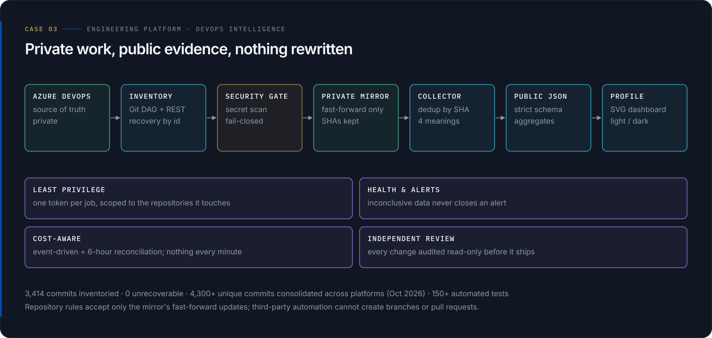

# Engineering Platform: representar trabajo privado sin falsearlo

<p align="right"><a href="engineering-platform.en.md">English</a> | <a href="engineering-platform.pt-BR.md">Português (Brasil)</a> | <b>Español</b></p>
## Contexto

La mayor parte de mi ingeniería cotidiana ocurre en repositorios privados de Azure DevOps. Un perfil de GitHub muestra solo lo que GitHub puede ver, así que esos commits, pull requests y revisiones eran invisibles allí. Copiar código, reescribir el historial o cambiar la autoría de los commits distorsionaría el trabajo.

## Desafío

Representar la actividad de ingeniería entre proveedores de modo que:

- cada número pueda rastrearse hasta un commit real;
- nada se reescriba, se reasigne de autor ni se atribuya a la persona equivocada;
- ningún código, secreto o nombre confidencial llegue a una superficie pública;
- el sistema funcione sin supervisión y avise cuando no tenga certeza.

## Mi rol

Diseño e implementación de la plataforma de punta a punta: inventario, validación de seguridad, espejado, métricas, agregación pública, modelo de autorización y runbook de operación.

## Arquitectura

<picture>
  <source media="(prefers-color-scheme: dark)" srcset="../assets/cases/engineering-platform-dark.svg">
  <source media="(prefers-color-scheme: light)" srcset="../assets/cases/engineering-platform-light.svg">
  
</picture>


```
Azure DevOps
  → inventario histórico (DAG de Git + REST, recuperación por id)
  → validación de seguridad (escaneo de secretos, política de rutas sensibles, fail-closed)
  → espejo privado unidireccional (solo fast-forward)
  → recolector de métricas (deduplicación por SHA)
  → agregación pública (schema estricto, solo agregados)
  → perfil de GitHub
```

**Inventario histórico.** Dos métodos independientes. El primero recorre el grafo de commits de Git en todas las refs anunciadas y obtiene por id los commits que Azure DevOps aún nombra pero que ninguna ref contiene, recuperando trabajo de ramas eliminadas. El segundo lee la API REST: refs, el listado de commits sin filtro y todos los pull requests con sus commits. Como el listado sin filtro no está documentado, se contrastó con el recorrido del grafo; los conjuntos pasaron a ser idénticos tras una corrección en la recuperación por id.

**Validación de seguridad.** Todo rango propuesto para transferencia se escanea con el conjunto completo de reglas predeterminadas de escaneo de secretos y con una política de rutas sensibles. Las excepciones son registros por fingerprint exacto, con clasificación, justificación, evidencia y revisores, además de una única regla acotada y revisada. La configuración del scanner está fijada por hash: cualquier edición bloquea el espejado hasta una nueva aprobación, y un validador rechaza las configuraciones que desactiven reglas o usen allowlists globales o sin ancla. Pruebas canario confirman que los secretos de apariencia real se siguen detectando. Una credencial real se rota primero, o el repositorio queda sin espejar.

**Espejo privado.** Azure DevOps sigue siendo la fuente de verdad. Un repositorio solo se espeja desde una allowlist explícita que registra categoría de autorización, aprobador, fecha y fundamento; el código corporativo o de terceros sin autorización de redistribución nunca se espeja, y los casos indefinidos quedan bloqueados. Los pushes usan refspecs explícitos de fast-forward, atómicos cuando varias refs avanzan juntas: sin force, sin eliminación, sin reescritura. La privacidad del destino se vuelve a comprobar justo antes de cada push y el resultado se verifica después. Todo commit espejado conserva su SHA, autor y fecha; las reejecuciones son idempotentes.

**Recolector de métricas.** Los commits de todas las plataformas se deduplican por SHA y se reportan como medidas separadas, con significados distintos: actividad de ingeniería, dónde vive el trabajo, fuentes, entrega y contribuciones oficiales de GitHub. El total del calendario oficial nunca se suma a la actividad de ingeniería, y los commits de terceros conservan a sus autores y nunca se cuentan como míos.

**Agregación pública.** El archivo público se construye campo por campo y se valida contra un schema estricto que falla en modo cerrado ante claves, strings o rangos desconocidos. Solo se publican agregados. Un validador del repositorio público bloquea nombres confidenciales comparando hashes truncados, de modo que la propia lista de bloqueo nunca se publica.

## Controles transversales

- **Tokens de mínimo privilegio por job.** Cada job recibe su propio token granular, de vigencia limitada y restringido a lo que necesita. Los tokens nunca aparecen en URL, argumentos, configuración ni logs, y todo registro de log pasa por redacción.
- **Health checks y alertas.** Cada espejo se clasifica (sincronizado, pendiente, desactualizado, divergente, ausente, no privado). Cualquier problema abre o actualiza una alerta privada; solo una ejecución saludable la cierra. Las verificaciones no concluyentes nunca cierran alertas.
- **Programación consciente del costo.** La reconciliación corre a intervalo fijo, con timeouts por job que acotan el peor caso de uso de runners y kill switches separados para el espejado y las métricas. El código privado se clona desde cero en cada ejecución, sin caché compartido.
- **Revisión independiente.** Las excepciones del escaneo de secretos se registran una por una, con justificación, y se revisan de forma independiente antes de entrar en vigor; la configuración del scanner está fijada por hash, de modo que cualquier cambio en ella es explícito.

## Decisiones y trade-offs

- **Representación por encima de la apariencia.** Con los squash merges, los commits de las feature branches nunca llegan a la rama por defecto y, por lo tanto, no pueden aparecer en el calendario de GitHub. Se cuentan en el dashboard, separados de las contribuciones oficiales.
- **Sin reescritura del historial.** Reescribir cambiaría todos los SHA. El costo: un hallazgo bloquea el repositorio hasta su triaje.
- **Un destino privado no es una autorización.** Espejar en privado no sustituye el permiso del dueño del código.
- **Fallar en modo cerrado.** La falta de autorización, un destino no privado, una divergencia, un bloqueo del scanner o un campo público desconocido detienen el pipeline en lugar de degradarlo.

## Resultados

- **3.414** commits inventariados en el origen Azure DevOps (todos los autores, historial completo, inventario de octubre de 2026), **0** irrecuperables.
- **Más de 4.300** commits únicos atribuidos a mis identidades Git, consolidados entre plataformas (todo el historial hasta octubre de 2026, deduplicados por SHA; la cifra en vivo está en el dashboard).
- Los commits elegibles en la rama por defecto para las contribuciones oficiales de GitHub, y cuántos de ellos el calendario aún no muestra, se reportan en el dashboard.
- **Más de 150** pruebas automatizadas.

## Estado actual y estado residual

- Los repositorios aprobados están espejados, y sus conjuntos de commits se verifican contra Azure DevOps por SHA, con las exclusiones de política aplicadas.
- Las reglas de repositorio en los espejos permiten únicamente las actualizaciones fast-forward del propio espejo; la automatización de terceros no puede crear ramas ni pull requests allí, y cualquier intento se monitorea.
- El calendario oficial se compara día a día con los commits elegibles: el dashboard muestra lo máximo que puede estar mostrando y cuántos comprobadamente aún no muestra. La diferencia se reporta, no se redondea.

## Lecciones aprendidas

- Los dos métodos independientes de inventario valieron el esfuerzo adicional: solo coincidieron después de corregir un bug en la recuperación por id.
- Los números que miden poblaciones distintas no son comparables sin una tabla de reconciliación explícita.
- Un espejo replica más que código. La automatización del repositorio viaja con él, así que los espejos necesitan controles propios.
- Lo no concluyente es un estado en sí mismo: una verificación que no puede confirmar nunca debe reportar recuperación.

## Lo que intencionalmente no se muestra

Nombres de repositorios y organizaciones (salvo Azure DevOps), nombres de clientes, direcciones de correo electrónico, nombres y alcances de tokens, fingerprints de escaneo, commits excluidos, detalles de incidentes, código fuente y capturas de pantalla.

---
<sub>Caso de estudio sanitizado. El código fuente es privado; esta página muestra únicamente arquitectura, decisiones y estado verificable. · <a href="../README.es.md">Volver al perfil</a></sub>
